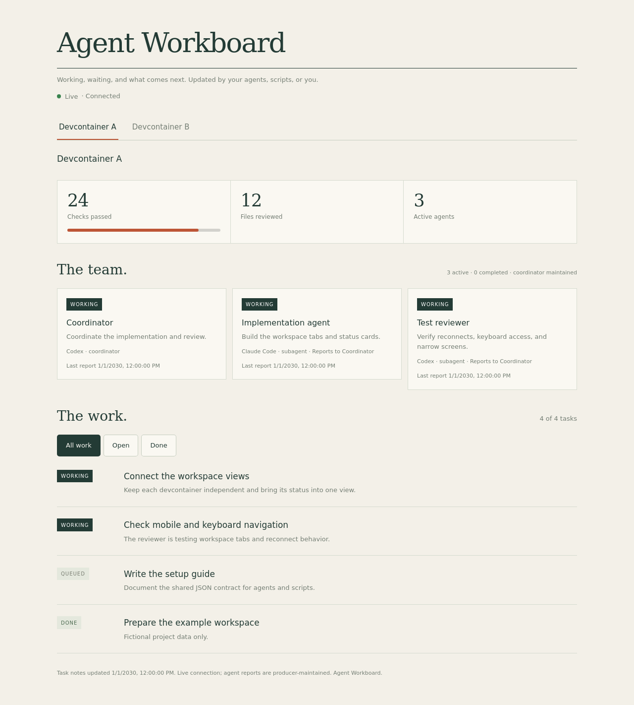
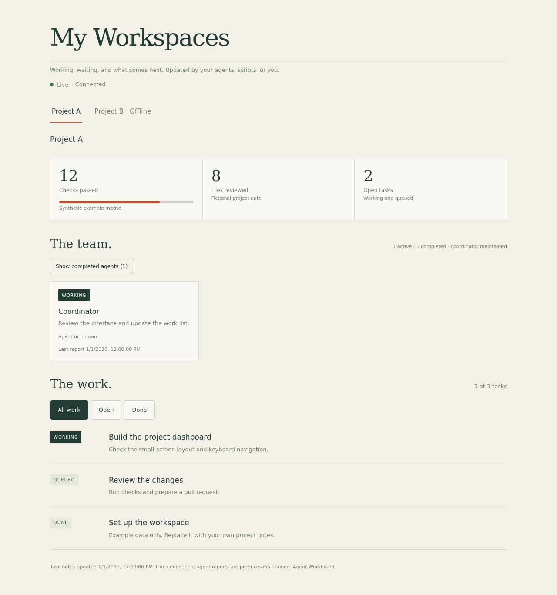

# Agent Workboard

A small, live dashboard for work happening in your projects. Works with Codex,
Claude Code, other agents, shell scripts, or a human editing JSON.

**One Python file. No runtime dependencies. No account, API key, or build step.**



## Try it in a minute

Requires Python 3.11 or newer:

```sh
git clone https://github.com/ayn/agent-workboard.git
cd agent-workboard
python3 workboard.py --demo
```

Open **http://127.0.0.1:8080**. The demo uses built-in fictional data and does
not read your project files. On Windows, use `py` in place of `python3`.

## Use it with your project

```sh
python3 workboard.py --init --state-dir ../my-project/.workboard
python3 workboard.py --state-dir ../my-project/.workboard --title "My Project"
```

`--init` creates example `tasks.json` and `team.json` without overwriting existing
files. Add `.workboard/` to your project's `.gitignore`, then replace the examples.
The directory is resolved relative to the command's working directory, not the
script location. An absolute path works too.

For an installed command, run `python3 -m pip install .`, then use
`agent-workboard` with the same arguments. Pin a release tag when sharing a setup.

### Connect Codex, Claude Code, or another agent

No extension, MCP server, model subscription, or special SDK is needed. Give the
agent the [setup instructions](docs/agent-setup.md), or paste this into the
project's `AGENTS.md` / `CLAUDE.md`:

> Keep `.workboard/tasks.json` updated as work starts, changes, waits, or finishes.
> Keep `.workboard/team.json` accurate for the coordinator and actual agents.
> Read the existing files first, preserve unrelated entries, and write atomically.
> Only the coordinator writes shared state; helpers report their updates to it.
> Never put secrets, personal data, private links, or raw payloads in board notes.
> Background jobs are tasks, not agents. Mark finished agents done and record
> each agent's `updated_at` only when that agent actually reports.

The board **does not observe an agent automatically** or execute tasks. It shows
what a producer reports. An open SSE connection means the board is connected,
not that a task or agent is running. Completed agents are hidden by default;
working cards with reports over 15 minutes old are marked as possibly stale.

### Update a task

Edit `tasks.json` with this shape:

```json
{
  "updated_at": "2030-01-01T12:00:00Z",
  "tasks": [
    {
      "id": "layout",
      "title": "Check the mobile layout",
      "status": "working",
      "detail": "Testing narrow screens and keyboard navigation."
    }
  ]
}
```

States: `working`, `background`, `waiting`, `queued`, `done`. Task links are
optional. The [example updater](examples/update.py) shows an atomic update using
only Python's standard library. Run it against a directory you initialized:

```sh
python3 examples/update.py ../my-project/.workboard
```

Task and agent changes appear without refreshing the browser. SSE sends a
snapshot immediately, pushes changed state, and sends a heartbeat every 15
seconds. The browser reconnects automatically. Page-code or startup-option
changes still require restarting the server and refreshing the page.

## Multiple projects or devcontainers

Each workspace can run its own producer, while one instance acts as the hub.
The browser needs access only to the hub; it does not contact the producers.

1. Start each producer with its own state directory and a reachable endpoint.
2. Create a **private** `sources.json` next to the hub's state:

```json
{
  "sources": [
    {"id": "project-a", "title": "Project A", "url": "http://127.0.0.1:8081/api/status"},
    {"id": "project-b", "title": "Project B", "url": "http://127.0.0.1:8082/api/status"}
  ]
}
```

3. Start the hub:

```sh
python3 workboard.py --sources /path/to/private/sources.json --title "My Workspaces"
```

The hub renders an underlined tab bar when there are multiple workspaces; with
only one workspace, the extra navigation is hidden. If a producer goes offline, its last known
snapshot stays visible with an unavailable warning; the other tabs keep working.
Use `--include-local` to include the hub's own state as a tab as well.



Inside containers, `127.0.0.1` means **that container**. Use reachable container
network names, a host gateway, or published host ports in the real config. Each
container can listen internally on port 8080, with different published host
ports. Bind producers to `--host 0.0.0.0` when required for container access.
Restrict those ports to your trusted network. On Docker Desktop, the hub can
often reach published ports through `host.docker.internal`.

The hub reads each source at most once every two seconds across browser clients,
with bounded request timeouts, no redirects, and a one-megabyte response limit.
Source URLs stay on the hub and are not sent to the browser. `/api/status`
always returns that instance's **local** state, preventing nested hubs from
recursively fetching one another. If the hub container stops, the combined view
stops too; run the hub on a more persistent host if you need it independent of
development containers.

For links in remote workspaces, use explicit absolute browser-facing URLs.
The hub omits producer-relative links such as `/preview` so they cannot
accidentally open the hub's own workspace preview. Local links still work in a
producer's standalone view. The hub does not proxy remote private files.

## Custom cards and integrations

Add optional `cards` and `links` to `tasks.json`; see [the JSON contract](docs/state-format.md).
Scripts can calculate metrics and publish presentation fields without coupling
the board to a particular project or service.

For a trusted local adapter, import `workboard` and call
`serve(Config(...), snapshot_fn=your_function)`. An adapter may explicitly map an
HTML preview file via `Config(file_routes={"/preview": Path(...)})`; the server
never browses or serves the surrounding directory. No adapters are loaded from
HTTP input. See [the adapter example](examples/adapter.py).

## Access and privacy

- Default bind: **127.0.0.1**, port 8080. There is no built-in authentication.
- The HTTP interface is read-only. Keep remote access behind your own trusted
  private network or authenticated reverse proxy; read-only does not mean public-safe.
- The server serves only `/`, `/api/status`, `/api/workspaces`, `/api/events`,
  and explicitly configured preview files. No directory listing or arbitrary file routes.
- Unknown JSON metadata is dropped. Text is rendered as text, and links are
  restricted to HTTP(S) or local paths. This is not a secret scanner: anything
  placed in a title, note, card, or other supported display field is meant to be shown.
- Invalid JSON retains the last good file contents and displays a warning.
- No analytics, tracking, external fonts, or remote JavaScript. No request logs by default.

This repository contains fictional examples only. It was created with a fresh
Git history; no personal workspaces, activity history, hostnames, or credentials
were imported.

## Development

```sh
python3 -m unittest discover -s tests -v
```

Tests exercise the real HTTP server, SSE reconnects, deterministic heartbeats,
projection boundaries, malformed files, workspace failures and caching. See
[CONTRIBUTING.md](CONTRIBUTING.md). MIT licensed.
